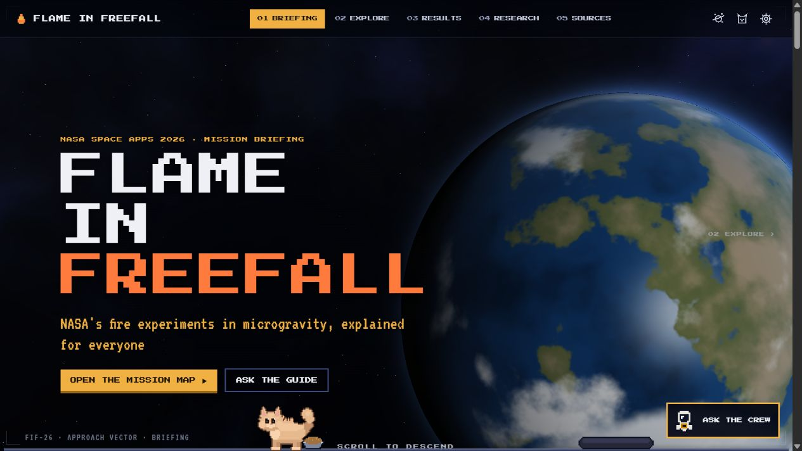
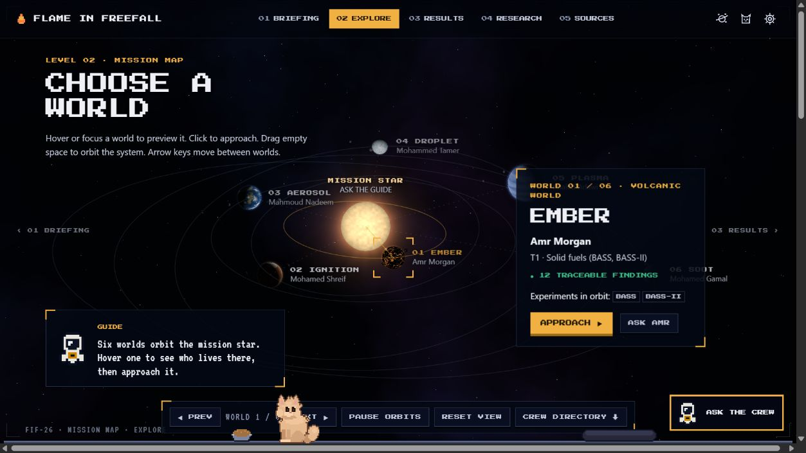
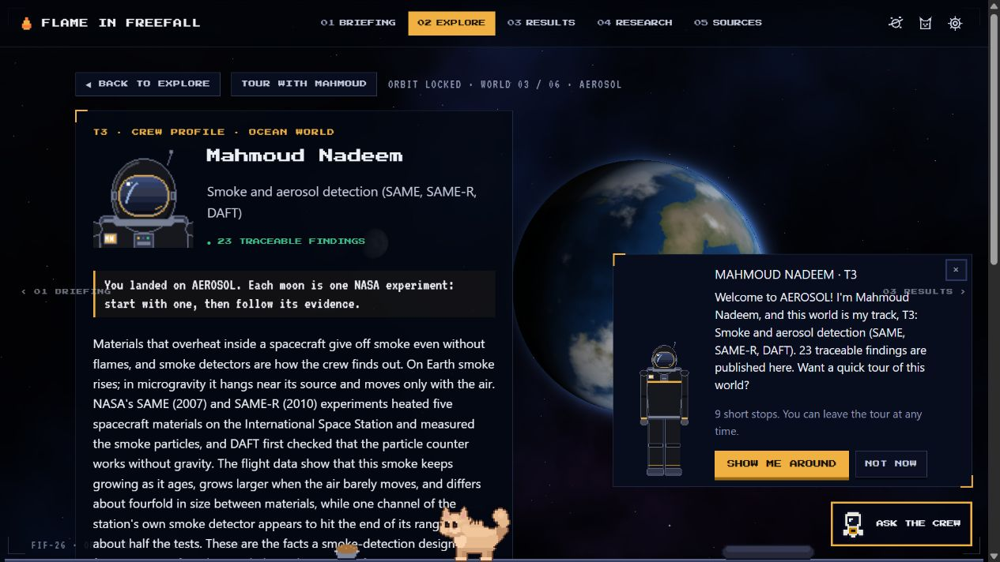
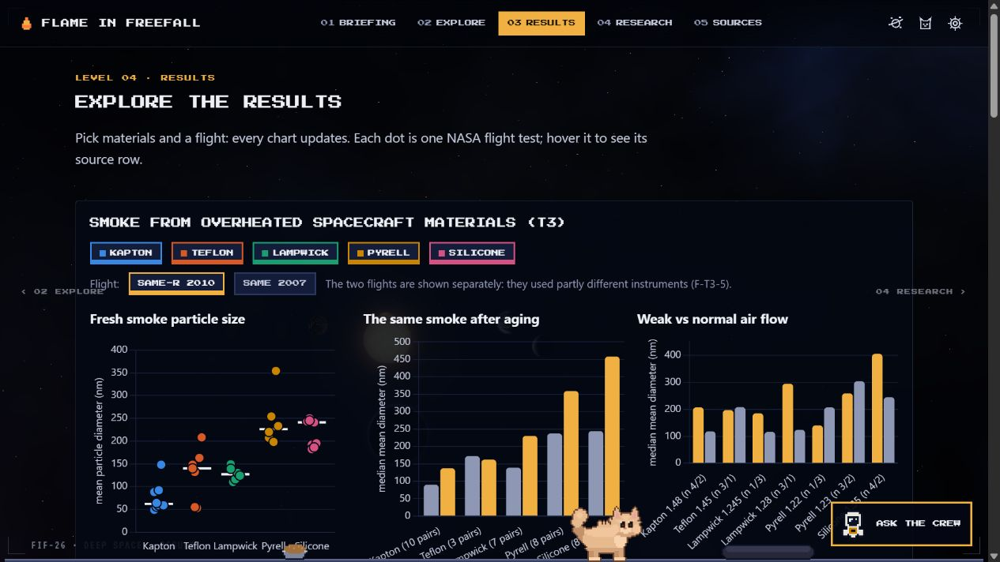
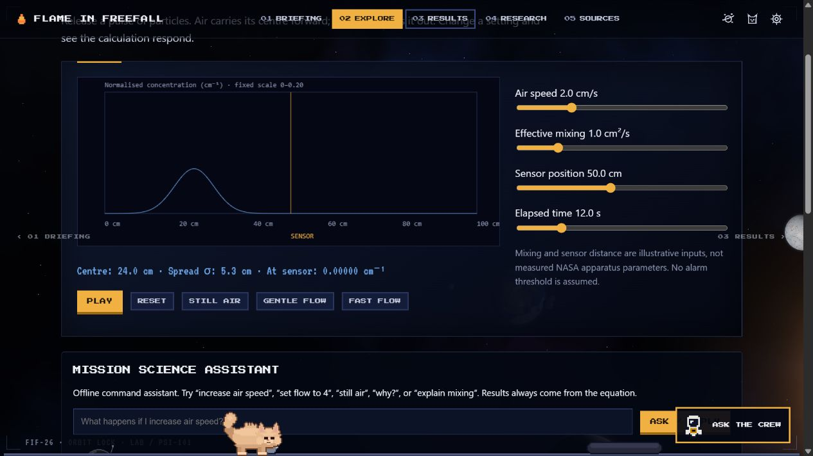
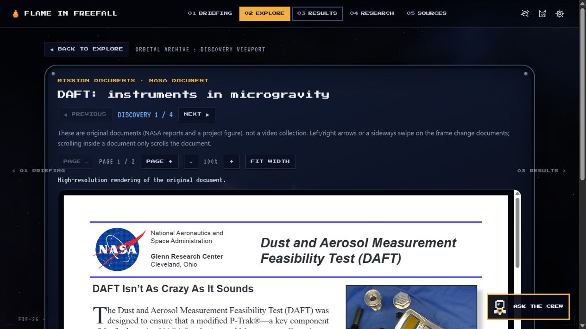
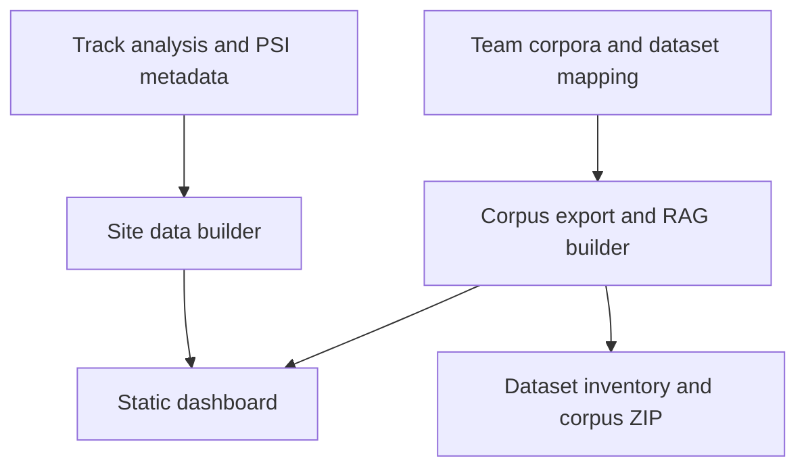

<div align="center">

# Flame in Freefall

### Explore the worlds. Meet the crew. Follow the evidence.

**An interactive journey through NASA's microgravity combustion experiments.**

Cinematic space exploration · Pixel astronaut guides · Traceable research · Interactive science

[Start locally](#quick-start) · [Explore the experience](#the-experience) · [Meet the team](#the-team) · [Understand the data](#science-and-evidence) · [Developer guide](#development)



**NASA Space Apps Challenge 2026 · Alexandria, Egypt**

</div>

## The mission

Flame in Freefall makes the team's work on NASA's Physical Sciences Informatics (PSI) experiments accessible through a space exploration interface. Each research track becomes a planet, each experiment becomes a destination, and each crew member helps visitors find the science behind their world.

Visitors can begin with a plain-language explanation, inspect interactive charts, try an educational transport model, and follow the evidence back to source files, rows, reports, and caveats. The same experience supports curious learners and readers who want to examine the analysis in detail.

The environment combines shaded, rotating planets with game-inspired controls, helmeted pixel astronauts, and **Bondoq (بندق)**, the crew's animated cat.

### Current project snapshot

| Research tracks | Experiments in the dashboard | Entries in the evidence table | Datasets with exported RAG content | Mission documents |
| :---: | :---: | :---: | :---: | :---: |
| **6** | **19** | **111** | **18** | **4** |

Snapshot: **15 November 2026**. The broader inventory contains **23 PSI datasets**, including four unassigned ground studies outside the dashboard. The evidence table includes observations, reported statements, and inferences; its total is not a count of independently validated discoveries. See the [dataset inventory](docs/DATASET_INVENTORY.md) and [integration report](docs/reports/FINDINGS_INTEGRATION_v10.md) for coverage and qualifications.

## Quick start

The committed website is ready to run. **No frontend build, npm install, account, or API key is required for the default experience.**

With Git and Python 3 available:

```bash
git clone https://github.com/mahmoud-nadeem/FlameMicrogravity.git
cd FlameMicrogravity
python -m http.server 8765 --bind 127.0.0.1 --directory fif-dashboard
```

Open **[http://localhost:8765](http://localhost:8765)**. On Windows, use `py` instead of `python` if that is how Python is installed.

You can also open `fif-dashboard/index.html` directly. A local HTTP server is recommended for the integrated PDF page, zoom, and fit-to-width controls; opening from disk uses a browser-dependent PDF fallback.

Once downloaded, the default dashboard uses bundled scripts, fonts, charts, documents, and crew knowledge. External source links and the optional online assistant require connectivity.

### A first journey

1. Read the **Briefing**, then open **Explore**.
2. Choose a world and meet its astronaut guide.
3. Open an experiment to read its purpose, findings, charts, and notes.
4. Visit **Results** to change filters and compare experiments.
5. Open **Research** for evidence labels, source locations, caveats, and CSV export.
6. Try **Follow the Smoke** from a T3 experiment, then inspect its model card.

## The experience

### A mission map with six research worlds

The map presents the research tracks as distinct planets orbiting a mission star. Hover or focus a world to preview its owner and experiments, then approach its research deck. A crew directory offers another way to reach every destination.



### Your own astronaut guide

Each world has an owner, a recognizable suit color, and a contextual tour. The guide introduces the sections available on that page, while the Crew panel provides access to the member's research knowledge. Dialogue is queued so messages retain their intended speaker.



### Interactive results with a path back to the data

Explore smoke particle size, aging, and airflow with material and flight filters. Additional crew charts cover SAFFIRE temperatures, FLEX outcomes, SLICE airflow, and SPICE campaign conditions. Experiment comparisons bring descriptions and selected findings together.

Charts include source notes and qualifications. SAME and SAME-R remain separate flight selections, and airflow comparisons retain the relevant heater-setting groups.



### A hands-on transport lab

**Follow the Smoke** lets visitors adjust air speed, effective mixing, sensor position, and elapsed time. A Gaussian advection–diffusion calculation updates the concentration profile and numerical readouts. Short commands such as `set flow to 4` configure bounded parameters through the offline command assistant.



This is an **educational, uncalibrated transport model**. It does not predict fire-alarm activation, detector response, or smoke particle growth. The separate particle animation is a qualitative illustration. Details are in [Science and evidence](#science-and-evidence).

### Original documents inside the spacecraft

The discovery viewport presents four bundled documents, including NASA reports and a project figure. Browse one document at a time, change pages, zoom, fit to width, or download the original PDF. Document scrolling and discovery navigation are separate controls.



### Small details that make the world feel alive

- **Bondoq:** walks, looks around, sits, grooms, visits his bowl, eats, curls up, sleeps, wakes, and stretches through a state-based animation system.
- **Astronauts:** closed reflective helmets, distinct suit colors, and idle, speaking, and pointing states.
- **Rocket cursor:** a space-themed pointer on compatible precise-pointer devices, with a normal-cursor fallback.
- **Minimal control dock:** view mode, Bondoq controls, and settings group the available preferences into compact menus.
- **Cinematic and Retro modes:** switch presentation while keeping the current route, conversation, and lab state.
- **Motion and accessibility:** keyboard controls, visible focus, reduced-motion behavior, optional character reactions, and sound off by default.

The screenshots above are actual captures of the local application, stored in [`docs/images/`](docs/images/).

## The team

Each member owns a research track and contributes its analysis and supporting knowledge. Mahmoud also leads the website concept, experience design, development, and integration.

| Track / world | Contributor | Research area and experiments | Evidence entries | Suit |
| --- | --- | --- | :---: | --- |
| **T1 · EMBER** | [Amr Morgan](https://github.com/Amr-Morrgan) | Solid fuels — BASS, BASS-II | 12 | Burnt orange |
| **T2 · IGNITION** | [Mohamed Sherif](https://github.com/mohamedshrief44) | Large-scale fire tests — SAFFIRE I, II, III | 13 | Green |
| **T3 · AEROSOL** | [Mahmoud Nadeem](https://github.com/mahmoud-nadeem) | Smoke and aerosol detection — SAME, SAME-R, DAFT | 23 | Black with amber trim |
| **T4 · DROPLET** | [Mohammed Tamer](https://github.com/Prjct5) | Droplets and cool flames — FLEX, FLEX-2, CFI, CFI-G | 23 | Blue |
| **T5 · PLASMA** | [Khaled Adawi](https://github.com/khaled266) | Gas flames — ACME BRE, E-FIELD, s-Flame, Flame Design | 19 | White |
| **T6 · SOOT** | [Mohamed Gamal](https://github.com/M-G-M-F) | Soot and smoke points — SPICE, SLICE, ACME CLD | 21 | Purple |

Mohamed Sherif appears as **Mohamed Shreif** in the current application; the stable crew ID is `shreif`. T4's current findings cover FLEX; its other listed experiments have records and knowledge content but no submitted findings yet.

Team analysis, text, code, and character work include AI assistance, as disclosed on the site's Sources page. Original scientific sources retain their attribution.

## Science and evidence

### Know what kind of statement you are reading

| Evidence category | What it means |
| --- | --- |
| **Observed in data** | A measurement or a calculation from the supplied experiment data; read its source and caveat. |
| **Reported by NASA or a publication** | A statement attributed to a source. Some entries record investigation aims rather than experimental outcomes. |
| **Our inference** | An interpretation made by the team, with its assumptions and limitations. |
| **Educational model output** | A value calculated from the transport equation and selected parameters. |
| **Qualitative illustration** | An explanatory animation that should not be read as measured or calibrated output. |

The Research view exposes finding IDs, confidence where supplied, source files, row/page references, and caveats. Missing confidence or verification is not filled in by assumption.

### Transport model

The lab implements a normalized pulse on an infinite one-dimensional axis:

$$
c(x,t)=\frac{1}{\sqrt{2\pi\sigma^2(t)}}\exp\left[-\frac{(x-ut)^2}{2\sigma^2(t)}\right],\qquad \sigma^2(t)=\sigma_0^2+2Dt.
$$

Here, `u` is air speed in cm/s, `D` is effective mixing in cm²/s, and the fixed initial width is `σ₀ = 2 cm`. The concentration is normalized per centimetre, not a measured particle concentration per cm³.

The model assumes constant flow and mixing, with no walls, buoyancy, deposition, coagulation, or chemistry. It is not calibrated against the NASA apparatus. See [`lab.js`](fif-dashboard/assets/js/lab.js) for the implementation and model card.

### Current coverage limits

- **RAG coverage:** no exported corpus yet for PSI-21 ACME CLD or the four unassigned studies. A missing corpus does not mean a dataset has no findings.
- **T4 findings:** FLEX-2, CFI, and CFI-G currently have no submitted findings.
- **Source availability:** some SAFFIRE sensor workbooks, Gamal's supporting analysis files, and cited supplementary tables are not included; affected statements retain their caveats.
- **Review status:** some investigation cards, metadata, dates, units, references, and confidence fields still need their authors' review.

For exact outstanding items, see the [integration report](docs/reports/FINDINGS_INTEGRATION_v10.md), [dataset inventory](docs/DATASET_INVENTORY.md), and [T1 review](docs/reviews/T1_Amr_v8_review.md).

## Crew knowledge and optional AI

The default assistant works locally. It combines curated Q&A and finding-based answers with BM25-style passage retrieval from dataset corpora. Crew members search the datasets mapped to their track; the mission guide can access all mapped datasets. Sources and evidence cautions accompany retrieved research answers.

This default mode requires **no hosted model or API key**. The [FAISS backend document](RAG/Flame%20in%20Freefall%20Backend%20and%20RAG%20Plan%20%28FAISS%29.md) is a design plan; the current browser retriever is implemented in [`rag.js`](fif-dashboard/assets/js/rag.js).

An optional Python proxy can connect an OpenAI-compatible chat endpoint. It supports context-based research answers and a separate general-science fallback. Keys remain in the server environment. To configure it, use [`tools/llm_proxy.py`](fif-dashboard/tools/llm_proxy.py), set `api_url` in [`content/chat.json`](fif-dashboard/content/chat.json), then rebuild the site data. The default `api_url` is empty.

## Technology

| Layer | Implementation |
| --- | --- |
| Website | Static HTML, CSS, and vanilla JavaScript; hash-based navigation |
| Space environment | Custom WebGL rendering with a 2D Canvas fallback |
| Scientific charts | Bundled Chart.js |
| PDF documents | Bundled PDF.js with a browser-PDF fallback for direct file access |
| Characters and companion | Local sprite sheets, Canvas/CSS animation, state-based behavior |
| Crew retrieval | Local JavaScript retrieval with generated corpus data |
| Data preparation | Python, pandas, NumPy, and track-specific analysis dependencies |
| Optional online answers | Python proxy and a configured OpenAI-compatible endpoint |
| Existing verification | Node test scripts, Python pytest suites, optional Playwright browser checks |

## Repository guide

| Path | Purpose |
| --- | --- |
| [`fif-dashboard/`](fif-dashboard/) | The runnable website, bundled assets, generated data, and browser-facing RAG content. |
| [`fif-dashboard/content/`](fif-dashboard/content/) | Editable project copy, crew definitions, chat settings, and other configuration. |
| [`flame-in-freefall-kit/`](flame-in-freefall-kit/) | Six analysis tracks, experiment cards, findings, charts, PSI metadata, and analysis tools. |
| [`flame-in-freefall/`](flame-in-freefall/) | Original team pipeline, schemas, investigation cards, catalog, ranking, and tests. |
| [`RAG/`](RAG/) | Submitted knowledge corpora and the authoritative crew-to-dataset mapping. |
| [`Findings/`](Findings/) | Retained plain-text and YAML submissions; integrated work lives in the analysis kit. |
| [`tools/export_rag_corpora.py`](tools/export_rag_corpora.py) | Dataset inventory and per-dataset corpus export, including provenance. |
| [`docs/`](docs/) | Assignment records, inventory, integration reports, reviews, and README screenshots. |

Submission ZIPs, old versions, original portrait/reference images, generated delivery archives, and raw-download caches are excluded from Git. Required processed assets and integrated scientific contributions are included. See [`.gitignore`](.gitignore).

## Development

### Keep the sources authoritative

Edit experiment content in the analysis kit and configuration in `fif-dashboard/content/`. Regenerate `site-data.js`, copied chart files, exported corpora, and `rag-data.js` instead of editing those outputs directly.



From the repository root, prepare Python dependencies if you intend to run the analysis/build tools:

```bash
python -m venv venv
```

Activate the environment with `venv\Scripts\Activate.ps1` in PowerShell or `source venv/bin/activate` on macOS/Linux, then:

```bash
python -m pip install -r flame-in-freefall-kit/requirements.txt -r flame-in-freefall/requirements.txt
```

### Update analysis and crew knowledge

1. Integrate a member's package into `flame-in-freefall-kit/analysis/T<n>/`, retaining the PSI IDs, evidence labels, sources, and caveats.
2. Add or update source corpora under `RAG/` and maintain `RAG/rag-map.json`. New source formats may also require an explicit mapping rule in the exporter.
3. Run the following commands from the repository root:

```bash
python fif-dashboard/build_site_data.py --kit flame-in-freefall-kit
python tools/export_rag_corpora.py
python fif-dashboard/build_rag.py
```

The exporter also produces `docs/dataset_inventory.json`, `docs/DATASET_INVENTORY.md`, the website's dataset folders, and a local `deliverables/rag-corpora.zip`.

**One source exception:** Tamer's original FLEX-2 corpus lives in [`fif-dashboard/rag/PSI-68_FLEX_II/rag_corpus_flex2.txt`](fif-dashboard/rag/PSI-68_FLEX_II/rag_corpus_flex2.txt). Preserve it: the exporter reads it as source material, and the RAG builder avoids reading its content twice.

Raw NASA downloads and original character reference images are not required to run the committed website. Recreating certain analyses or regenerating sprites may require those separate inputs. Refer to the relevant track README or asset script before rebuilding them.

### Existing checks

Checks are available for development; they are not part of the quick-start process.

<details>
<summary>Show optional verification commands</summary>

Run the JavaScript suites from the repository root in PowerShell:

```powershell
Get-ChildItem fif-dashboard/tests/*.test.cjs | ForEach-Object {
    node $_.FullName
    if ($LASTEXITCODE -ne 0) { throw "Failed: $($_.Name)" }
}
```

Or in Bash:

```bash
for test in fif-dashboard/tests/*.test.cjs; do
  node "$test" || exit 1
done
```

Python suites run from their respective project directories:

```bash
cd flame-in-freefall-kit
python -m pytest -q
cd ../flame-in-freefall
python -m pytest -q
cd ..
```

For the optional browser suite, install Playwright and its Chromium browser in your development environment, then run `node tests/browser.e2e.cjs` from `fif-dashboard/`. The script starts its own local server.

Track handoffs can also be reviewed with `python tools/self_check.py T3` from `flame-in-freefall-kit/`; replace `T3` with the relevant track. A successful code test does not certify the scientific evidence.

</details>

### Static hosting

Publish the **contents of `fif-dashboard/`** as the static site's document root. Keep its relative asset paths and bundled data together. Hash routes handle navigation without separate server routes for each experiment.

For an optional online assistant, host the proxy separately, keep credentials on the server, and configure the site's endpoint and allowed origin. Publishing the static dashboard alone does not deploy a model backend.

## Sources, credits, and reuse

Scientific records and documents retain their NASA PSI and publication references. Dataset licensing and verification status are recorded in their metadata; consult the specific source before reuse.

Bundled dependencies retain their notices: [Chart.js](fif-dashboard/assets/vendor/chart.js-LICENSE.md), [PDF.js](fif-dashboard/assets/vendor/pdfjs/LICENSE), [Press Start 2P](fif-dashboard/assets/fonts/press-start-2p-LICENSE.txt), and [VT323](fif-dashboard/assets/fonts/vt323-LICENSE.txt).

No repository-wide software license is currently included. Dataset and dependency licenses do not automatically license all team-created code, writing, or artwork.

For more implementation detail, see the [dashboard guide](fif-dashboard/README.md), [RAG source guide](RAG/README.md), and [team pipeline contribution guide](flame-in-freefall/CONTRIBUTING.md).

---

<div align="center">

**Built by Team Flame in Freefall**
Six research tracks. One shared mission to make the evidence explorable.

</div>
